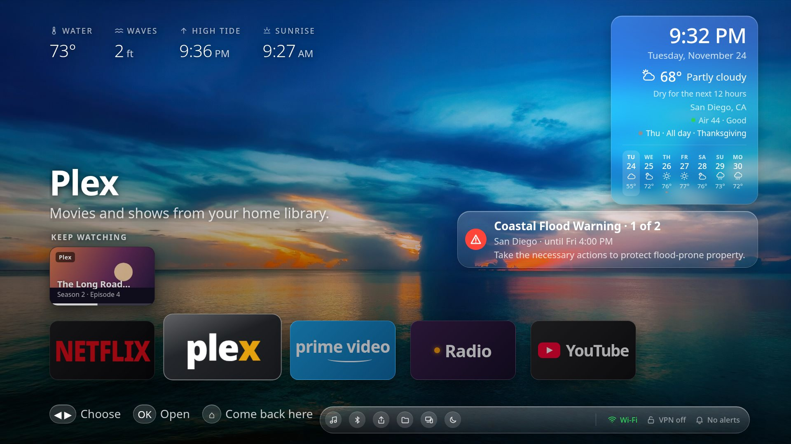
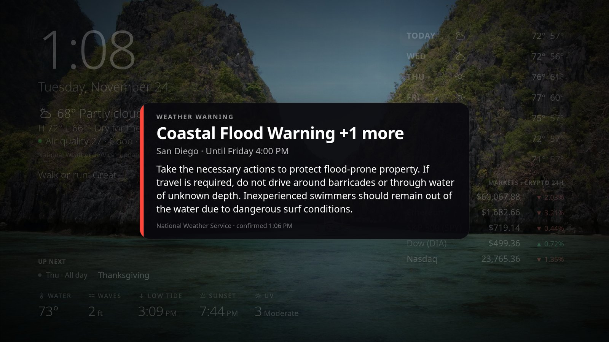
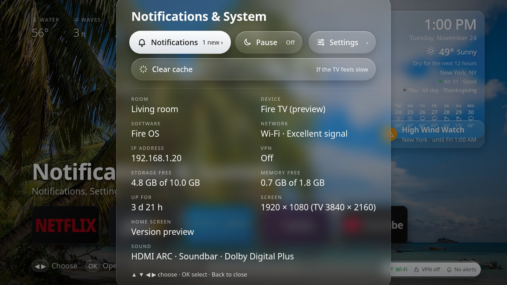

# Offshore

**An ad-free home screen for Amazon Fire TV.**

[](LICENSE)
[](#requirements)
[](https://offshoreupdates-web.github.io/offshore/latest.json)


Fire TV's own home screen is built to sell: sponsored rows, autoplaying trailers, "recommended for you". Offshore
replaces it with a quiet one. Your apps in one row, a photo or slow video behind them, the weather, and the controls
you use most one press away. No ads, no account, no tracking.

The Amazon home screen stays installed underneath. Turn Offshore off and the TV is exactly as it was.

| | |
|---|---|
|  |  |
| **Keep watching** shows what you were watching in the app you're on. | **The screensaver** is a smart mirror you lay out yourself. |
|  |  |
| **Settings** explain every option on screen. | **Backgrounds** from five free, credited sources. |
|  |  |
| **Setup** takes about two minutes and can be skipped. | **Notifications & System** for the TV's details. |

## Features

**Home screen**
- Apps in one row, most used first. Move, pin, hide or uninstall them from the remote; new apps get a tile automatically.
- Seven layouts (Classic, Mirrored, Game day, Clean, Big & clear, Apps only, Cinema). Panels resize so nothing overlaps.
- **Keep watching**: the show or film you were in and how far you got, for any app that reports playback to Android
  (Netflix, YouTube, Prime Video, Disney+, Plex, Fox One and others). Link a Plex account for Plex's own list; Plex's
  code sign-in means Offshore never sees your password.
- Weather from the National Weather Service: today, the next 12 hours, a 7-day forecast, air quality (EPA AirNow) and
  beach conditions (NOAA tides, waves, water temperature; EPA UV index). US only.

**Backgrounds**
- 41 photo sets from Wikimedia Commons, NASA, The Met, the Art Institute of Chicago and the Library of Congress, plus
  search across all five. Photos follow the time of day.
- 43 live video sets (1080p, silent) from Wikimedia Commons and NASA, plus video search. Streamed, or kept on the TV.
- Your own photos and videos from a phone or a network folder (SMB or NFS).
- Every photo and clip is credited on screen with its author and licence.

**Alerts and information**
- Life-threatening weather warnings and emergency alerts (AMBER, evacuation, shelter in place) appear over any app,
  with a sound. Other warnings show on the home screen and screensaver.
- Screensaver: clock, forecast, your teams, markets, news headlines and your calendar. Choose what goes where.
- Calendars from Google, iCloud, Outlook and others: open the address the TV shows on your phone, enter the code,
  paste the calendar link.
- Sports scores for the teams you follow (MLB, NHL and ESPN's public scoreboards).

**Tools on the bottom bar**
- Now playing for any music app, with album art and the audio output (HDMI, soundbar, Bluetooth).
- Bluetooth, Wi-Fi, a sleep timer, screen mirroring, and receiving files from phones over LocalSend.
- Files: browse the TV, USB drives and network folders; open, rename, copy, move and delete.
- Live TV from your own M3U playlist (played in VLC) and internet radio from Radio Browser, local stations first.
- Task manager: memory, storage, recent apps, and uninstall by size and last use.

**Settings**
- 15 folders, every option explained on screen, optional PIN.
- Settings back up on the TV and restore after a reinstall.
- Updates check the official release only, on a schedule you set, and show the release notes first.

## Requirements

- A Fire TV device on Fire OS 7 or 8. Tested on the Fire TV Cube (3rd gen) and the Fire TV Stick 4K Max (2nd gen).
- Fire TV devices on Vega OS can't install apps from outside Amazon's store, so Offshore can't run on them.
  Settings › My Fire TV › About shows which you have.
- A computer, once, to grant the permissions Fire OS has no screen for (see step 3 below).

## Installing

1. On the TV: Settings › My Fire TV › Developer options › ADB debugging: On. Note the TV's IP address
   (Settings › My Fire TV › About › Network).
2. Download the APK linked as `apk` in the [release feed](https://offshoreupdates-web.github.io/offshore/latest.json),
   then install it with adb (from Android's platform-tools):
   ```
   adb connect <TV address>:5555
   adb install offshore-<version>.apk
   ```
3. Turn on the Home button, music controls, app usage and the developer access switch:
   ```
   pwsh -File tools/setup_tv.ps1 -Ip <TV address>:5555
   ```
   It prints each setting's state. `-Undo` turns them all off again.

After that, Offshore checks the release feed for updates. A download installs only if its SHA-256 matches the feed and
it's signed with the same key as the installed app, and only after you press Install.

## Building

Needs PowerShell (Windows PowerShell, or PowerShell 7 on Linux and macOS). No Android Studio or Gradle.

```
pwsh -File tools/setup_toolchain.ps1
pwsh -File launcher/android/build.ps1 -VersionCode 1 -VersionName 0.1
```

The first script downloads the JDK, Android's build tools and the libraries from their official sources and checks
each one's hash. The second builds `apks/offshore-0.1.apk`, signed with a test key unless a release key is set up (see
`build.ps1`). On Windows, use `powershell -ExecutionPolicy Bypass -File` with backslashes.

To work on the interface without a TV:

```
pwsh -File tools/serve_preview.ps1
```

Then open http://localhost:8765/?tv=example. Arrow keys, Enter and Esc stand in for the remote.

### Code layout

```
launcher/android/   the Android app (Java): WebView host, Home-button service, LocalSend, network folders, updates
launcher/web/src/   the interface: shell.html, css/ and js/, joined in order by tools/assemble_web.ps1
launcher/web/img/   built-in background photos (credits in img/CREDITS.txt)
tools/              build, preview, setup and release scripts
config/             example.json, a sample per-TV config
```

The JavaScript parts share one scope, as if they were one script.

## Privacy and security

- No account, no analytics, no ads. Settings stay on the TV.
- Every outside service is named in the app and in [CREDITS.md](CREDITS.md), and most can be turned off.
- Web requests go over HTTPS to the services named in the code, plus the calendars, playlists and network folders you
  add. The one plain-HTTP case is radio stations that only stream unencrypted, which the app relays to itself on the TV.
- Permissions that change security settings are never granted automatically; you grant them from a computer.

Details and how to report a problem: [SECURITY.md](SECURITY.md).

## Contributing

Bug reports, ideas and pull requests are welcome. Every change is reviewed before it's merged, and only releases
signed with the project's key reach TVs: Fire OS installs an update only when it's signed with the same key as the
installed app, and that key is not in this repository.

Before opening a pull request, build it, try it in the preview, and keep personal details (addresses, tokens, your
own TV's config) out of commits.

## Licence

[GNU General Public License v3](LICENSE). The libraries Offshore includes (Apache 2.0, MIT and the Bouncy Castle
licence) are listed with their full texts in
[launcher/web/licenses/THIRD-PARTY-NOTICES.txt](launcher/web/licenses/THIRD-PARTY-NOTICES.txt), which also ships in
the app. Credits for photos, videos and data: [CREDITS.md](CREDITS.md).
