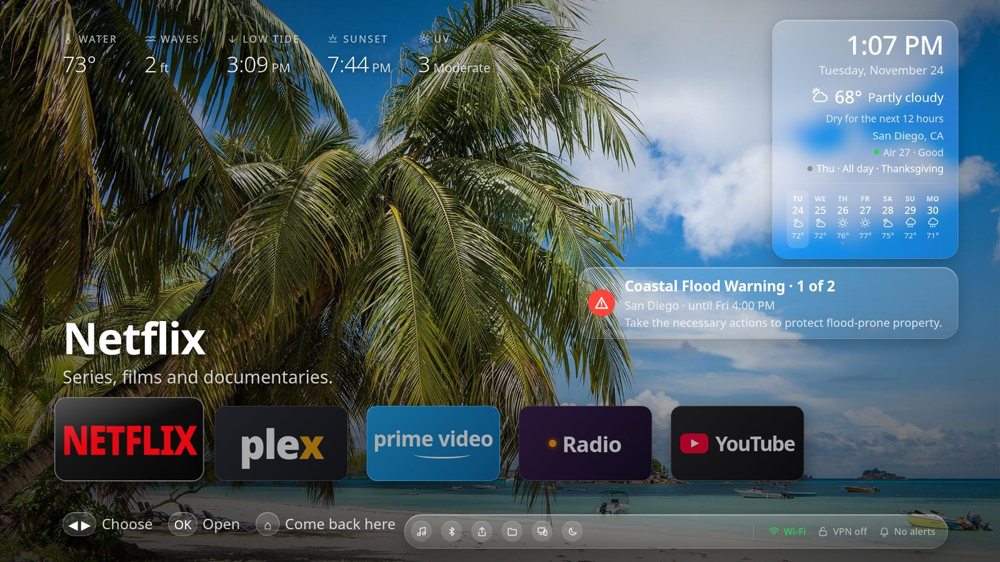
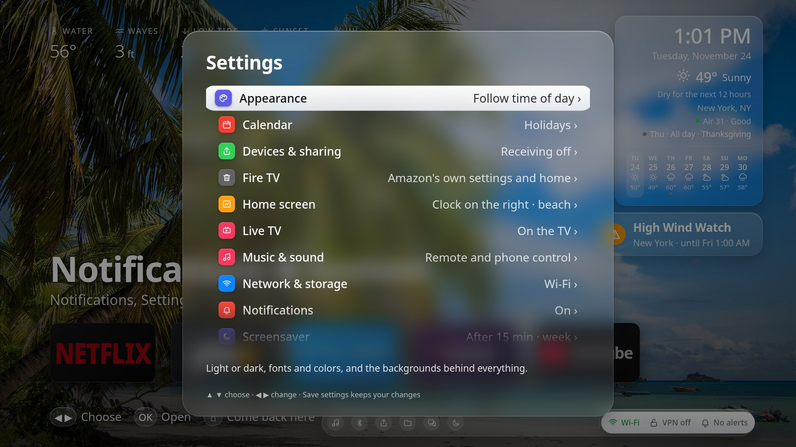
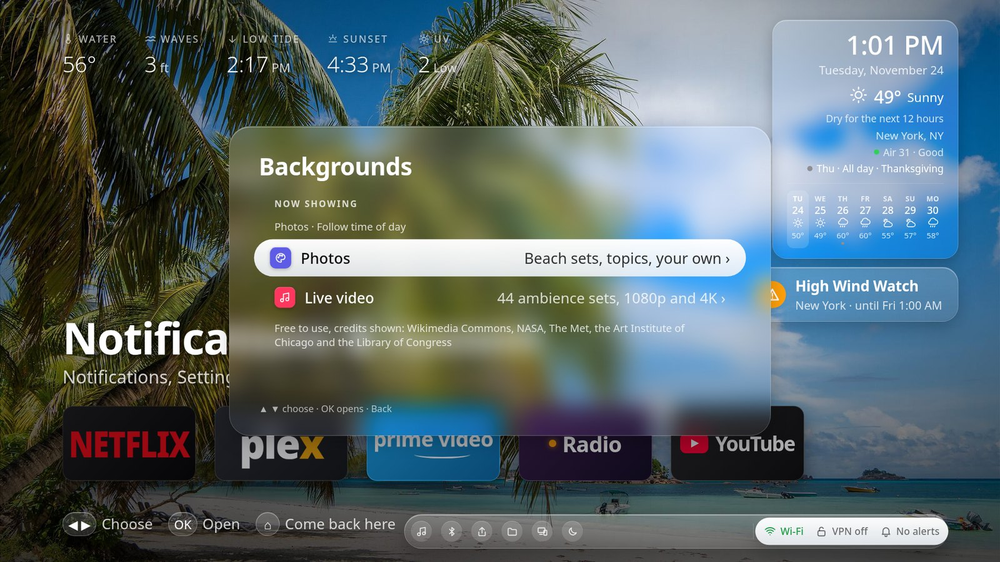
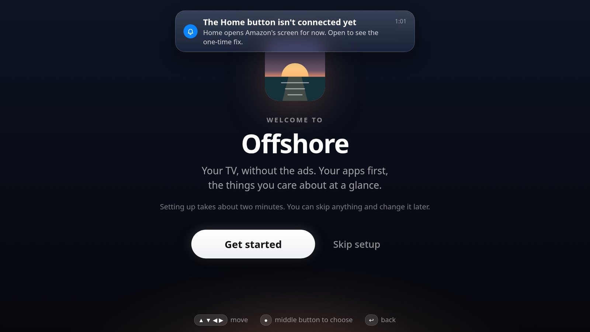

# Offshore

**No ads. No clutter. Take back your Fire TV.**

[](LICENSE)
[](#installing-on-a-fire-tv)
[](https://offshoreupdates-web.github.io/offshore/)



You paid for the TV box. You shouldn't have to scroll past sponsored rows, autoplaying trailers and "recommended for
you" to get to the apps you actually use. Offshore replaces the Amazon home screen with a quiet one that's yours:
your apps in one row, big calm photos that follow the time of day, the weather, and the things you reach for most
(music, Bluetooth, sharing from your phone, a sleep timer) one click away. Nothing on it is selling you anything.

Like an offshore wind that flattens the surf, it clears the noise so the screen is calm again.

| | |
|---|---|
|  |  |
| **Keep watching** picks up where you left off, in any app. | **The screensaver** is a calm smart mirror. Weather warnings show over it. |
|  |  |
| **Settings** explain every option on screen. | **Backgrounds** from Wikimedia Commons, NASA, The Met and more. |
|  |  |
| **A two-minute welcome** you can skip. | **Notifications & System**: your TV at a glance. |

## In short

> An ad-free home screen for Fire TV. Your apps, your photos, the weather, music controls and a sleep timer, with no
> sponsored rows, no autoplay and no tracking. Take back your device.

## Features at a glance

> Offshore is a free, open-source home screen for Amazon Fire TV that gets the ads and clutter out of your way.
>
> - **No ads, ever.** No sponsored rows, no autoplaying trailers, no "featured" content. Just your apps.
> - **Yours to arrange.** Apps sit in one row, sorted the way you like. New apps get a matching tile by themselves.
> - **Calm to look at.** Big photos that change with the time of day, over thirty hand-checked photo sets, your own
>   pictures, or live video backgrounds (beaches, reefs, national parks, cities, cozy scenes, holidays), and a clean
>   smart-mirror screensaver.
> - **Looks out for you.** Life-threatening weather, AMBER Alerts and other emergencies show over whatever you're
>   watching, with a sound. Press OK and the movie carries on.
> - **Easy to set up.** A short welcome walks you through the basics and shows off what Offshore can do.
> - **The useful stuff, one click away.** Now playing with album art for any music app, Bluetooth, receiving photos
>   and files from your phone (LocalSend), a file manager for the TV, USB drives and your NAS, and a sleep timer.
> - **You stay in control.** Every setting is explained on screen, an optional PIN keeps guests out of them, and
>   updates only come from official, stable releases on a schedule you pick.
> - **Nothing removed, nothing broken.** The Amazon home stays installed and untouched underneath. Turn Offshore off
>   and your Fire TV is exactly as it was.
>
> No account, no analytics, no data sold. Just your TV, back the way it should be.

It runs on Fire TV devices with Fire OS 7 or 8: tested on the Fire TV Cube (3rd gen, Fire OS 7) and the Fire TV Stick
4K Max (2nd gen, Fire OS 8). Newer sticks on Amazon's Vega OS can't install apps from outside Amazon's store, so it
can't run there (Settings > My Fire TV > About shows which you have). The Amazon home screen stays installed and
untouched; Offshore sits on top of it and can be removed at any time.

## Why Offshore

Your Fire TV came with a home screen built to sell to you. Offshore is the other way round: a calm screen that's
yours, where every part can be moved, resized or switched off and nothing is selling you anything. Nothing on the TV
is removed or broken, so turning it off puts everything back exactly as it was. There's no account, no ads, no
analytics and no data sold; settings stay on the TV, and every source of information is named on screen and can be
turned off.

It's free and open source, made for the community: anyone can read the code, see exactly what it does, suggest a
change or build their own version. The same words are in the app, under Settings > Updates & about > About Offshore.

## What it does

- **Welcome setup and tour**: on a new install, a few calm screens (room, location, °F/°C, screensaver look and
  background, each shown live), where Offshore's own settings are, a "Make it yours" screen that opens the real
  settings for teams, news, stocks, backgrounds, layout, fonts, sounds, sharing, calendar, notifications and the speed
  test, a spotlight tour of the home screen, and an optional checklist for the extras that need a computer. Every
  screen can be skipped; Settings > Updates & about > Replay setup & tour runs it again.
- **Home screen**: apps in one row (A to Z, most used first), title and description above the focused tile, tiles for
  newly installed apps added by themselves. Hold OK on a tile to hide or remove it; press ☰ on a tile to move it
  (◀ ▶) or pin it to the front (▲), as on Fire TV's own home.
- **Home screen layouts and auto-fit**: Classic, Mirrored, Game day, Clean, Big & clear, Apps only and Cinema, tried
  live from a chooser along the bottom. Whatever the layout or sizes, panels measure themselves and step down in size
  so nothing ever overlaps; the screensaver's corners do the same.
- **Backgrounds**: Photos (beaches by time of day; 33 photo sets in Beach & ocean, Nature, Sky & space, Cities &
  landmarks, Holidays & seasons, Cars & boats and Sports, each checked by eye and drawn from Wikimedia Commons'
  reviewed Featured and Quality pictures, downloaded only when picked, and each following the time of day: sunsets
  around sunrise and sunset, daytime photos by day, night shots at night; paintings from The Met and the Art Institute
  of Chicago, NASA's photos of Earth and deep space, colour photos from around 1900 from the Library of Congress; your
  own searches across all five free sources; or a folder on your NAS) or
  **Live video**: silent 1080p clips behind the home screen and screensaver, about 40 hand-checked sets from Wikimedia
  Commons and NASA (Earth from the space station, the Sun up close), and your own video searches, in Beach & ocean, Underwater, National parks & wonders, Around the world, Nature, Cities, Cozy and Holidays &
  seasons. Streamed by default (no storage), or kept on the TV; videos sent from a phone can be one too. Highlighting a
  set plays it behind the list. Credits for every photo and clip.
- **Keep watching**: a row over the app you're on with what you were watching in it and how far you got. It works
  with any app that tells Android what's playing (Netflix, YouTube, Prime Video, Disney+, Plex, Fox One and the rest),
  plus Live TV channels, radio stations and videos from your files. Link your Plex account (a code you enter at
  plex.tv/link, so Offshore never sees your password) for Plex's own Continue watching list. OK opens the app right
  where you were.
- **Holidays & seasons**: a live background that changes by itself for New Year's, Valentine's Day, St. Patrick's
  Day, Easter, Mother's and Father's Day, Memorial Day, the 4th of July, Halloween, Veterans Day, Thanksgiving and
  Christmas, and with the seasons in between.
- **Fonts and colours**: Modern, Light, Condensed or Classic serif lettering (built into the TV, so offline), eight
  accent colours, tinted glass and an accent-coloured highlight.
- **Speed test**: download, upload and ping from open test servers (M-Lab, or Cloudflare if M-Lab can't be reached),
  with a plain-English verdict. Runs only when you ask.
- **Location**: found automatically from your internet connection when you set up, or type a ZIP code. Automatic
  location is checked again at start and every few hours, so a Fire TV Stick you travel with follows you (a VPN makes
  it guess the VPN server's city; a typed ZIP code stays put).
- **Weather and local info**: National Weather Service forecast and alerts, today's high and low and the one thing
  coming up (rain, storms, wind or a dry spell), a 7-day view, beach conditions from NOAA (water temperature, waves,
  tides) and the EPA (UV). It says when it was last updated and turns amber when the data is old or the TV is offline.
  Alerts carry the National Weather Service's instructions; on the screensaver, warnings show in the middle and
  life-threatening ones fill the screen. US only for now.
- **Serious alerts over any app**: life-threatening weather (tornado, hurricane, flash flood emergency and the like) and
  the emergencies local officials send through the Weather Service (AMBER Alerts, evacuations, shelter in place, civil,
  hazardous-material and nuclear warnings) appear over whatever is playing, large and with a sound you choose. A movie
  pauses so the sound can be heard (surround sound can't be mixed in); OK closes the alert and the movie carries on.
  Phones also get FEMA's alerts, whose feed needs FEMA's approval, so keep yours on too.
- **Notifications**: slide in where you choose (any top or bottom corner, or the center) and slide away; the last 30
  are kept to read in full.
- **Sports**: favourite teams with record, live score, last result and next game.
- **Screensaver**: a smart-mirror screen over the photo with the clock, weather, the week ahead, walking/running
  conditions, your teams, markets (stocks and crypto you pick), local and national news, and a greeting. Design it
  yourself: put each item in a corner or the centre, change the order, larger text, or start from a ready-made layout.
- **News**: local news for your location plus national, world, official government (White House, Department of War,
  FBI, Justice Department), cybersecurity (CISA, actively exploited CVEs from CISA's catalogue, new data breaches from
  Have I Been Pwned, Krebs on Security, BleepingComputer and more), technology and space.
  Switch whole topics or single sources on and off.
- **Air quality** from the EPA's AirNow monitors nearest the TV, and walking/running conditions that take it into account.
- **Sleep sounds**: brown, pink and white noise, ocean, rain and fan made on the TV, or free sounds you search for;
  volume, a turn-off timer and a darkened screen.
- **Task manager**: memory, storage, temperature, the apps used today, close them or open their Fire TV page, and
  Uninstall apps: every app you installed with its size and when it was last used, least used first (Fire TV asks to
  confirm; the tile goes at once).
- **Files** (on the bottom bar): what's using the TV's space (apps, photos, videos, music, other files, system), and
  the TV's folders, USB drives, files from phones and your network folder (NAS or computer, SMB or NFS), with each
  file's kind, size, date and time, sorted how you like. Open, rename, copy, move and delete (always asked first);
  photos open full screen, videos, music and documents open in an app that can play them. App installers never open.
- **Live TV**: your own channels from a playlist (M3U) your TV provider or a legal service gives you, added from your
  phone, in a guide with groups and recently watched; they play in VLC (free, from the Amazon Appstore). Offshore
  includes, finds and suggests no channels or providers, and the link stays on the TV, out of its backups.
- **Radio**: free internet radio from stations' own public streams, listed by Radio Browser (radio-browser.info, an
  open directory; no account). Near you puts the FM and AM stations licensed within about 60 miles first (the FCC's
  list, matched by call sign, with frequency and city), then your state, then News & talk, Sports, Country and more
  with your state's stations first, and search for any station in the world. Favorites and recently played stay on
  the TV. It plays in Fire TV's own player and shows in the bottom bar; music or a video in another app stops it.
- **Calendar**: Google, Apple iCloud, Outlook, Proton, Yahoo, Fastmail and school or team calendars, added from your
  phone (the TV shows an address and a code); events you add on the TV; US holidays. Shown in the clock panel, the week
  view and the screensaver's Up next.
- **Settings backup**: settings back themselves up on the TV and restore by themselves after a reinstall.
- **What's new and About**: release notes after each update and before installing one, and why Offshore exists.
- **Notifications you can open**: Notifications & System > Notifications lists the last 30 and OK reads one in full
  (update notices open to their release notes).
- **Permissions & setup**: shows which optional permissions are on; `tools\setup_tv.ps1` turns them all on from a
  computer in one go (Fire OS has no screen for them).
- **Fine-tuning the home screen**: clock panel left, right or off and its size; beach and scores on either side; the
  week under the clock; app names, icons-only bottom bar and the help line can each be switched off.
- **Bottom bar**: now playing (any music app, with real album covers, and where the sound is going: HDMI, soundbar
  or Bluetooth, and the rate), Bluetooth, Share (LocalSend, with an optional code shown right on the Share card),
  screen mirroring (opens Fire TV's own receiver in one press, for Android phones and Windows laptops), sleep timer, and Wi-Fi / VPN / notification status. "Open a music app" lists only the music
  apps you have.
- **Settings**: fourteen folders, A to Z, every setting explained on screen, optional PIN so guests can't change
  things. Amazon's own Fire Settings and Fire TV Home are in Settings > Fire TV.
- **Light on the TV**: while another app is on screen, Offshore freezes its own timers and steps out of the way (it
  only wakes every 5 minutes to check for alerts), so Plex, Netflix and the rest get the TV to themselves.
- **Updates**: checks official sources on a schedule you pick, with the release notes; quiet notes when apps or Fire
  OS update.

## Building

You need Windows and PowerShell, or Linux and PowerShell 7 (`pwsh`; run the same scripts with `pwsh -File` and
forward slashes). No Android Studio or Gradle.

```
powershell -ExecutionPolicy Bypass -File ".\tools\setup_toolchain.ps1"
powershell -ExecutionPolicy Bypass -File ".\launcher\android\build.ps1" -VersionCode 1 -VersionName 0.1
```

The first command downloads the JDK, Android's build tools and the libraries (official sources, each checked). The
second builds `apks\offshore-0.1.apk`, signed with a test key unless you set up a release key (see `build.ps1`).

To work on the interface without a TV:

```
powershell -ExecutionPolicy Bypass -File ".\tools\serve_preview.ps1"
```

then open http://localhost:8765/?tv=example in a browser. Arrow keys, Enter and Esc stand in for the remote.

## Installing on a Fire TV

1. On the TV: Settings > My Fire TV > Developer Options: turn on ADB debugging. Note the TV's IP address
   (Settings > My Fire TV > About > Network).
2. On the PC: `tools\platform-tools\adb.exe connect <TV address>:5555`, accept the prompt on the TV, then
   `adb install apks\offshore-0.1.apk`.
3. Turn on the Home button, music controls, the Task manager's app list and the developer access switch (these
   change security settings on the TV, so they're yours to grant):

   ```
   powershell -ExecutionPolicy Bypass -File ".\tools\setup_tv.ps1" -Ip <TV address>:5555
   ```

   It prints on/off for each; `-Undo` turns them off again. Settings > Security & privacy > Permissions & setup on
   the TV shows the same. Fire OS has no screen for these and doesn't let apps reach its developer connection, so this
   one step needs a computer.

## How the code is laid out

```
launcher/android/   the Android app (Java): home screen host, Home-button service, LocalSend, NAS, Bluetooth/Wi-Fi
launcher/web/src/   the interface, in parts: shell.html, css/ and js/ (numbered; joined in order)
launcher/web/img/   background photos (credits in img/CREDITS.txt)
tools/              build, preview and helper scripts
config/             example.json, a sample TV config (copy it, don't commit your own)
```

`tools/assemble_web.ps1` joins the interface parts into the single page the TV loads. The JavaScript parts share one
scope, as if they were one script, so a part can call a function defined in a later part.

## Status

Early. It runs daily on two Fire TV Cubes, including live backgrounds and LocalSend from a real phone. Some features
are only tested up to the point a real device was needed (NAS, Bluetooth pairing, joining Wi-Fi). 4K live backgrounds
are built but switched off for now.

## Contributing

Ideas, bug reports and pull requests are welcome. Every change is reviewed by the maintainer before it's merged, and
only releases the maintainer builds and signs reach TVs: Fire OS installs an update only when it's signed with the same
key as the app already on the TV, and that key is never in this repository. So anyone can read, copy or fork the code,
but nothing reaches your TV without that review.

Before sending a change: build it (`launcher/android/build.ps1`), try it in the preview (`tools/serve_preview.ps1`),
and keep personal details (addresses, tokens, your own TVs' settings) out of commits. `config/*.json` other than
`example.json` is ignored for that reason. Security reports: see [SECURITY.md](SECURITY.md).

## Licence

Offshore is free software under the [GNU General Public License, version 3](LICENSE). You can use, study, share and
change it; versions you share must stay under the same licence, with their source.

It includes open-source libraries under their own licences (Apache 2.0, MIT and the Bouncy Castle licence), listed with
their full texts in [launcher/web/licenses/THIRD-PARTY-NOTICES.txt](launcher/web/licenses/THIRD-PARTY-NOTICES.txt),
which also ships inside the app. Photo, video, data and library credits are in [CREDITS.md](CREDITS.md), and in the app
under Settings › Updates & about › About Offshore.
